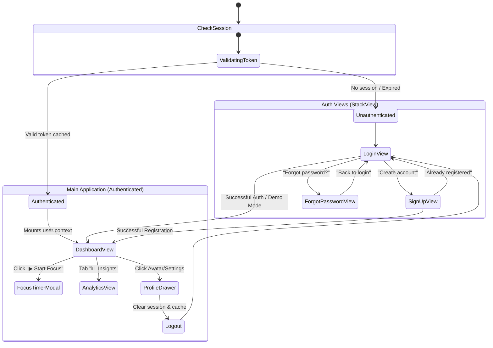

# 🚀 Architecture & Specification: Activity Tracker v2.0
## Complete Multi-Screen Application with Authentication, Neon Serverless DB, & Executive Productivity Tools

This document defines the production architecture, database schema, state management, and user flows for **CVS Activity Tracker v2.0**.

---

## 📑 Table of Contents
1. [Executive Summary & Tech Stack](#1-executive-summary--tech-stack)
2. [Multi-Screen Architecture & Navigation Flow](#2-multi-screen-architecture--navigation-flow)
3. [Authentication & Session Engine](#3-authentication--session-engine)
4. [Neon Serverless DB & Multi-User Cloud Architecture](#4-neon-serverless-db--multi-user-cloud-architecture)
5. [Interactive Focus Timer & Micro-Interactions](#5-interactive-focus-timer--micro-interactions)
6. [Power Toolbar & Daily Standup Export](#6-power-toolbar--daily-standup-export)
7. [Productivity Forecast & Analytics Dashboard](#7-productivity-forecast--analytics-dashboard)
8. [Phased Rollout Matrix](#8-phased-rollout-matrix)

---

## 1. Executive Summary & Tech Stack

Activity Tracker v2.0 transitions the POC from a single-screen desktop utility to a multi-screen, cloud-connected workstation:

* **Core Platform:** C++17, Qt 6.8+, QML (Qt Quick / Controls 2).
* **Cloud Database:** Neon Serverless PostgreSQL 18 (AWS `ap-southeast-1` connection pooling endpoint with SSL).
* **Database Driver:** `Qt6::Sql` with the native PostgreSQL driver (`QPSQL`) and `libpq`.
* **Threading Model:** Multi-threaded asynchronous I/O (`QtConcurrent` / `QThreadPool`) — database operations run entirely on background threads to ensure the QML UI thread maintains a rock-solid 60/120 FPS.
* **Security & Session:** Client-side PBKDF2/SHA-256 password hashing, secure token persistence via `QSettings`, and environment isolation (`.env` guarded by `.gitignore`).

---

## 2. Multi-Screen Architecture & Navigation Flow

The top-level window manages screen transitions using a root `StackView` driven by an authenticated state machine:



### Screen Layouts:
1. **`LoginView.qml`**: Split-pane modern desktop layout.
   * *Left Pane:* Rich branding graphic, productivity metrics preview, and feature highlights.
   * *Right Pane:* Email & password input fields with show/hide password toggle, "Remember Me" checkbox, "Sign In" button, and "⚡ Quick Demo Mode" for 1-click evaluation without signing up.
2. **`SignUpView.qml`**:
   * Full Name, Email, Password, and visual password strength meter.
   * Workday preference selector (e.g. Daily Target: 2h, 4h, 6h, 8h).
3. **`ForgotPasswordView.qml`**:
   * Email verification input, verification code verification, and secure password reset.
4. **`DashboardView.qml`**:
   * The primary tracker workstation featuring the live focus timer, analytics cards, filter toolbar, and responsive activity list.
5. **`AnalyticsView.qml`**:
   * Visual category time distribution bars, 7-day focus history chart, and productivity streak badges.
6. **`ProfileDrawer.qml`**:
   * User profile management, daily target goal slider, Neon DB cloud connection status, and logout button.

---

## 3. Authentication & Session Engine

### C++ Architecture (`AuthService`)
The authentication logic is encapsulated in `src/service/AuthService.h/.cpp` and registered as a QML singleton or context property:

```cpp
class AuthService : public QObject
{
    Q_OBJECT
    Q_PROPERTY(bool isLoggedIn READ isLoggedIn NOTIFY authStateChanged)
    Q_PROPERTY(QString currentUserId READ currentUserId NOTIFY authStateChanged)
    Q_PROPERTY(QString currentUserName READ currentUserName NOTIFY authStateChanged)
    Q_PROPERTY(QString currentUserEmail READ currentUserEmail NOTIFY authStateChanged)
    Q_PROPERTY(bool isSyncing READ isSyncing NOTIFY syncingChanged)

public:
    explicit AuthService(QObject *parent = nullptr);

    Q_INVOKABLE void login(const QString &email, const QString &password, bool rememberMe);
    Q_INVOKABLE void registerUser(const QString &name, const QString &email, const QString &password, int dailyGoalMinutes);
    Q_INVOKABLE void resetPassword(const QString &email, const QString &newPassword);
    Q_INVOKABLE void loginDemoUser(); // 1-click test mode
    Q_INVOKABLE void logout();

signals:
    void authStateChanged();
    void loginSuccess();
    void authError(const QString &errorMessage);
    void syncingChanged();
};
```

### Password Security & Hashing
Passwords are never transmitted or stored in plaintext. Passwords are hashed using `QCryptographicHash::hash(salt + password, QCryptographicHash::Sha256)` before storing in the PostgreSQL `users` table.

---

## 4. Neon Serverless DB & Multi-User Cloud Architecture

### Database Schema Definition
Executed automatically on first connection to `neondb`:

```sql
-- 1. Users Table
CREATE TABLE IF NOT EXISTS users (
    id VARCHAR(64) PRIMARY KEY,
    name VARCHAR(255) NOT NULL,
    email VARCHAR(255) UNIQUE NOT NULL,
    password_hash VARCHAR(255) NOT NULL,
    daily_goal_minutes INTEGER NOT NULL DEFAULT 240,
    created_at TIMESTAMPTZ NOT NULL DEFAULT NOW()
);

-- 2. Activities Table (User-Isolated Multi-Tenancy)
CREATE TABLE IF NOT EXISTS activities (
    id VARCHAR(64) PRIMARY KEY,
    user_id VARCHAR(64) NOT NULL REFERENCES users(id) ON DELETE CASCADE,
    name VARCHAR(255) NOT NULL,
    category VARCHAR(64) NOT NULL,
    duration_minutes INTEGER NOT NULL,
    done BOOLEAN NOT NULL DEFAULT FALSE,
    created_at TIMESTAMPTZ NOT NULL DEFAULT NOW()
);

-- Indices for instant query response times
CREATE INDEX IF NOT EXISTS idx_activities_user_id ON activities(user_id);
CREATE INDEX IF NOT EXISTS idx_activities_created_at ON activities(created_at);
```

### Threading & Zero-Latency Desktop I/O
To prevent cloud round-trip latency (50–150ms) from causing GUI frame drops:
1. **Immediate Local Mutation:** When an activity is added or toggled, `ActivityListModel` updates immediately (0ms latency, UI renders at 60/120fps).
2. **Asynchronous Background Worker:** A background task dispatched via `QtConcurrent::run` pushes the SQL query (`INSERT`, `UPDATE`, or `DELETE`) to the Neon DB connection pooler.
3. **Offline Fallback:** If internet access drops or Neon is unreachable, changes are persisted to `%APPDATA%/activities.json` and synchronized upon reconnection.

---

## 5. Interactive Focus Timer & Micro-Interactions

Every activity card in [`qml/components/ActivityCard.qml`](../qml/components/ActivityCard.qml) acts as an active countdown companion:

### Timer State Machine:
* **Idle State:** Shows duration pill (e.g. `⏱ 45 min`) and a `▶ Focus` button.
* **Running State:**
  * Displays live countdown: `44:59`, `44:58`...
  * Progress ring / animated underline smoothly fills as time advances.
  * Card exhibits a subtle ambient glow matching its category color (Electric Blue for Work, Amber Gold for Learning, Emerald Green for Personal).
* **Paused State:** Allows pausing and resuming focus sessions.
* **Completed State:**
  * When time reaches `00:00`, the card plays a subtle chime, triggers a checkmark pop animation, and invokes `activityService.markComplete(index)`.

---

## 6. Power Toolbar & Daily Standup Export

Located directly above the activity list:

### Features:
1. **Dynamic Sort Dropdown:**
   * 🕒 **Recent** (Newest first)
   * ⏱️ **Duration (Shortest first / Longest first)**
   * 🔤 **Alphabetical (A → Z)**
2. **Batch Action (`🧹 Clear Done`):**
   * Visible only when completed tasks exist.
   * Removes all completed activities in one click with smooth slide-out physics.
3. **Daily Standup Export (`📋 Export Standup`):**
   * Compiles today's activities into formatted Markdown ready for Slack, Teams, or Jira:
     ```markdown
     ### 📋 Daily Standup Summary — 2026-11-04
     **Completed Activities:**
     - [x] Code Review (45m) — *Work*
     - [x] Study Qt/QML (30m) — *Learning*

     **In Progress / Planned:**
     - [ ] Daily Standup (15m) — *Work*

     **Total Focus Time:** 90 mins (1.5 hrs) • **Completed:** 2/3 (67%)
     ```
   * Automatically copies to the system clipboard and triggers a floating confirmation toast.

---

## 7. Productivity Forecast & Analytics Dashboard

### Dynamic Forecast Engine
Calculates the estimated completion time based on unfinished activities:
$$\text{Estimated Finish Time} = \text{Current Time} + \sum \text{Pending Duration Minutes}$$
Displayed prominently in [`StatsDashboard.qml`](../qml/components/StatsDashboard.qml):
> *"3 tasks pending (75m remaining) • Estimated completion: 5:45 PM"*

### Focus Streak Tracker
Maintains consecutive days where at least 1 activity was completed (e.g., *"🔥 3-Day Focus Streak"*).

---

## 8. Phased Rollout Matrix

| Milestone | Deliverables | Target Files |
|---|---|---|
| **Milestone 1: Auth Engine & Views** | `AuthService.h/.cpp`, `LoginView.qml`, `SignUpView.qml`, `ForgotPasswordView.qml`, `main.qml` StackView navigation. | `src/service/AuthService.*`, `qml/views/auth/*` |
| **Milestone 2: Focus Timer & Glows** | Card countdown timer, progress ring, category hover glows, checkmark pop animation. | `qml/components/ActivityCard.qml` |
| **Milestone 3: Power Toolbar & Export**| Sorting selector, `Clear Done` batch action, Markdown Standup export to clipboard. | `qml/main.qml`, `src/service/ActivityService.*` |
| **Milestone 4: Neon DB Multi-User Sync** | `Qt6::Sql` linkage, `PostgresStore.h/.cpp`, schema migration, multi-user isolation. | `CMakeLists.txt`, `src/persistence/PostgresStore.*` |
| **Milestone 5: Analytics & Settings** | `AnalyticsView.qml`, `ProfileDrawer.qml`, daily target gauge, streak tracking. | `qml/views/AnalyticsView.qml`, `qml/components/ProfileDrawer.qml` |
